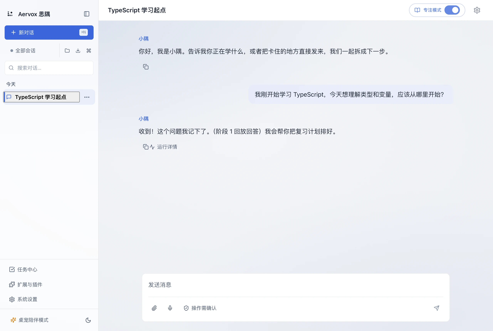
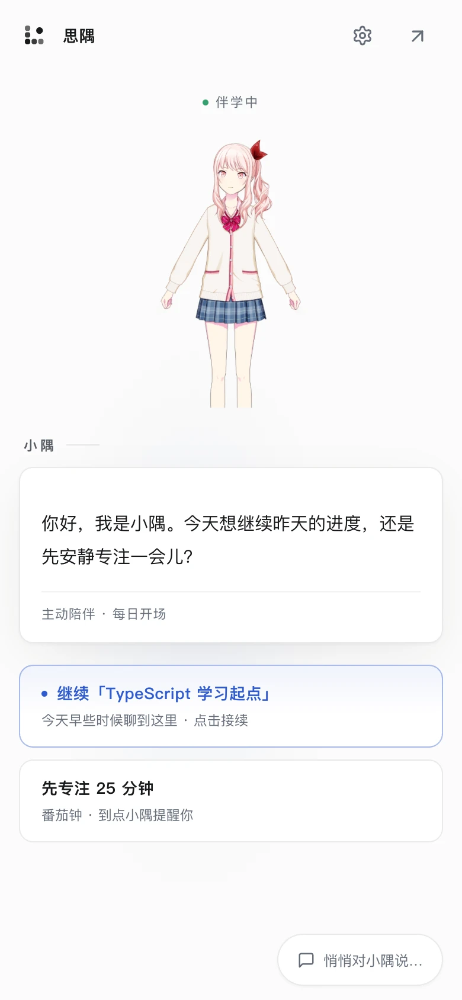
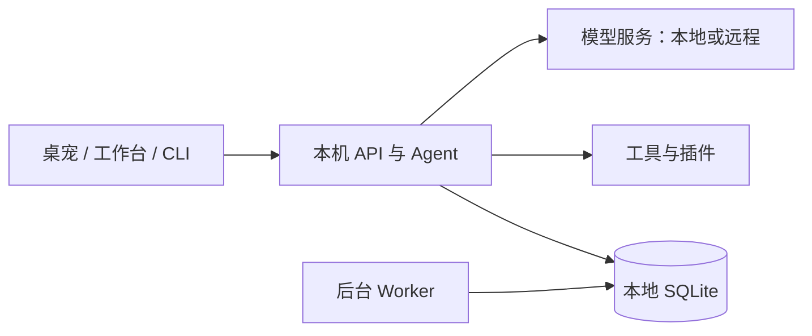

#  Aervox｜思隅

以桌宠和工作台为入口的学习与陪伴 Agent，帮助编程学习者提问、练习和复习。个人记录保存在本地，模型服务可按需选择。

**开发者预览** · 能力验收与发布状态见[需求追踪](docs/reference/REQUIREMENTS_TRACEABILITY.md)。升级前请备份本地数据。

[开始体验](docs/getting-started.md) · [文档导航](docs/README.md) · [参与贡献](CONTRIBUTING.md)

## 看看思隅

<a id="工作台把对话和学习放在一起"></a>

### 桌面端：角色陪在身边，工具随手可用



角色在左，工具与对话在右。用卡片管理待办、回看对话，在输入区继续提问；回复支持流式显示与停止生成，也可查看运行详情。

桌面默认使用这套“桌宠陪伴”工作台；在“设置 → 通用 → 外观 → 交互模式”中，也可切换到侧栏多会话的“标准工作台”。

<a id="主动陪伴从一句问候开始"></a>

### 移动端：从一句问候开始



手机和平板默认使用主动陪伴界面：接续最近会话、进入专注，或展开“悄悄话”提问。设置和停止回复随手可达；建议当前来自最近会话与固定动作。

截图使用独立演示数据；回复为确定性回放，不代表真实模型效果。Live2D 模型来源与许可见[模型说明](packages/live2d/mizuki/README.md)。移动界面的浏览器适配不代表原生移动应用已发布，验收状态见[需求追踪](docs/reference/REQUIREMENTS_TRACEABILITY.md#mobile-decisions)。

## 可以做什么

- **连续对话与陪伴**：在工作台、桌宠或终端连接版中交流，沿用本机服务的会话与配置。
- **学习与复习**：通过学习插件进行引导、练习和反馈，将复习安排交给后台任务。
- **个人记忆与日记**：整理会话记忆与每日复盘，保留来源和数据管理入口。
- **工具与插件**：按需启用第一方插件、Skill 和 MCP 工具，通过审批管理需授权的操作。

以上为已有实现的概览，完整验收状态与剩余限制见[需求追踪](docs/reference/REQUIREMENTS_TRACEABILITY.md)。

## 快速开始

先安装 [mise](https://mise.jdx.dev/getting-started.html)，再在仓库根运行：

```bash
git clone https://github.com/3yearsZhuang/Aervox-harness.git
cd Aervox-harness
./aervox setup
./aervox dev web
```

打开 [Web 工作台](http://127.0.0.1:5173)，进入“设置 → 模型服务”，填写供应商、Base URL、Model ID 和必要的 API Key，点击“测试连接”并“保存配置”，再开始对话。

需要已有可用的模型服务；安装项目不会自动安装模型。`setup` 可能更新锁文件，详情见[完整入门指南](docs/getting-started.md)。

浏览器体验启动 API 与 Web；复习、日记等异步处理还需 Worker。要同时运行桌宠和后台服务，停止当前开发服务后运行：

```bash
./aervox dev
```

终端连接版、单独启动 Worker、端口配置与排错见[入门指南](docs/getting-started.md#2-配置与启动)。

## 同一本机服务，多种入口



个人记录以本地 SQLite 为真源；模型调用是否出网取决于服务配置。技术细节见[架构说明](docs/reference/ARCHITECTURE.md)。

## 继续了解

| 想了解什么 | 从这里开始 |
|---|---|
| 安装、配置与首次对话 | [入门指南](docs/getting-started.md) |
| 产品目标、功能与数据责任 | [文档导航](docs/README.md) |
| 模块关系与 Agent 内核 | [架构说明](docs/reference/ARCHITECTURE.md) |
| 开发插件、Page 或 UI 扩展 | [扩展指南](docs/how-to/develop-plugin-ui-extension.md) |
| 提交贡献与运行检查 | [贡献指南](CONTRIBUTING.md) |
| 当前进展与后续安排 | [当前计划](plan.md) · [需求追踪](docs/reference/REQUIREMENTS_TRACEABILITY.md) |

## 许可

独立内核 `packages/core` 使用 [Apache-2.0](packages/core/LICENSE)，其余主仓源码使用 [AGPL-3.0-or-later](LICENSE)，文档使用 [CC BY-NC-SA 4.0](docs/LICENSE)。第三方资源遵循各自许可与来源声明。
