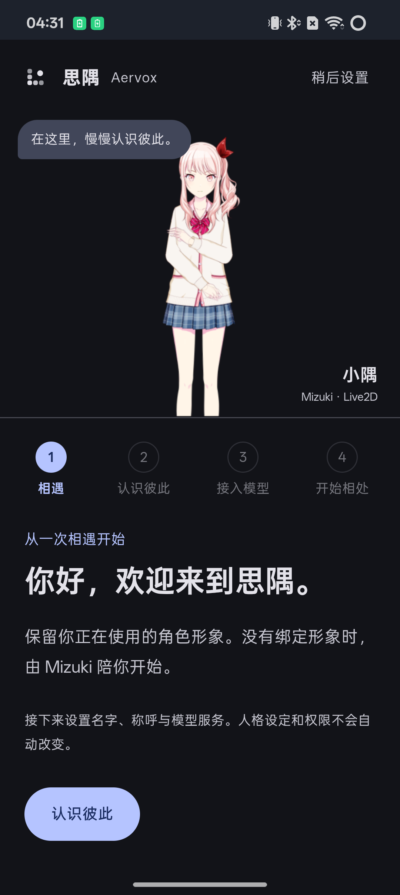

# 第 9 批：APK 瘦身 66% 与启动耗时测量

**结论：APK 从 422 MB 降到 145 MB（-66%），启动行为不变；首次安装后的引导流程完整可用。**



## APK 瘦身

| 项 | 瘦身前 | 瘦身后 |
|---|---|---|
| APK | 422 MB | **145 MB** |
| rootfs 资产 | 382 MB（未压缩 `.tar`） | **110 MB**（`.tgz`） |
| 压缩比 | 1:1 | 3.6:1 |

### 关键：`noCompress` 与扩展名的关系

第 6 批曾判定「资产必须用未压缩 `.tar`，否则 Gradle 会解压导致字节数失配」。本批发现这个结论**只是半对**：

- 扩展名 `.tar.gz` 不在 `noCompress` 列表里时，AGP 会识别 gzip 并解压成 `.tar`，导致清单声明的字节数与实际不符
- 把列表改为 `listOf("gz", "tgz", "xz", "zst", "tar")` 并**使用 `.tgz` 扩展名**后，资产按原始字节打包

`.tar.gz` 为何仍失败而不深究——`.tgz` 已验证可用，且语义相同。这是一个「换扩展名绕过 AGP 启发式」的实用解法，代价是资产名不那么常见。

### 另一个必须避免的坑

`app/src/main/assets/runtime/` 与 `runtime/out/<abi>/assets/` **两个位置的文件都会被打包**。清瘦身时只改了后者，前者残留的旧 `.tar.gz` 让 APK 一度涨到 528 MB。

瘦身必须同时清理：

```sh
rm -rf app/android/app/src/main/assets/runtime
rm -rf app/build/app/intermediates/assets
```

## 启动耗时

设备 OPPO PMA110 / Android 17 / arm64。

| 阶段 | 耗时 |
|---|---|
| Activity 冷启动（`am start -W`） | **742 ms** |
| — TotalTime / WaitTime | 742 / 746 ms |
| rootfs verify | 139–521 ms |
| rootfs extract（110 MB tgz → 382 MB） | 7.0–8.2 s |
| 用户组名同步 | 311–483 ms |
| 激活 | 319–496 ms |
| **首次安装（解压全流程）** | **约 8 秒** |
| **已安装后启动到 API 就绪** | **约 15 秒** |

首次安装 8 秒远低于 dsh-Go 文档记载的 40 秒–2 分钟，原因是本仓 rootfs 不含 DSH 与完整 Ubuntu 包管理，只有基础系统 + Node + Aervox API。

「已安装后 15 秒」包含 Node 启动、插件装配、数据库打开；其中插件装配占比较大（两个插件装配失败也在此阶段抛出）。

## 观察到的现象（需后续解释）

> **本节判断已被 [第 10 批](foreground-service-anr-fix.md) 更正。**
>
> 当时观察到「应用被系统回收后重新打开会完整冷启动」，我判定这是未验证的保活问题、不属于缺陷。
>
> 实际是**必现的 ANR 崩溃**：`DshService` 在 `startForegroundService()` 之后未履行 `startForeground()` 义务，系统按 ANR 终止进程。已修复。
>
> 原判断保留在此作为当时的误判记录。

## 首次引导流程

重装后（应用数据清空）首次启动显示完整引导：

- 四步流程：相遇 → 认识彼此 → 接入模型 → 开始相处
- Live2D 角色「小隅（Mizuki）」正常渲染与动画
- 文案说明「保留你正在使用的角色形象」与「人格设定和权限不会自动改变」

这套引导来自主仓的共享四步配置流程，说明**前端能力完整继承**，不是简化的移植版。

## 下一步

1. 冷启动优化：插件装配耗时、Node 启动预热
2. 后台保活验证（前台服务 + 系统回收恢复）
3. 配置模型跑通真实对话
