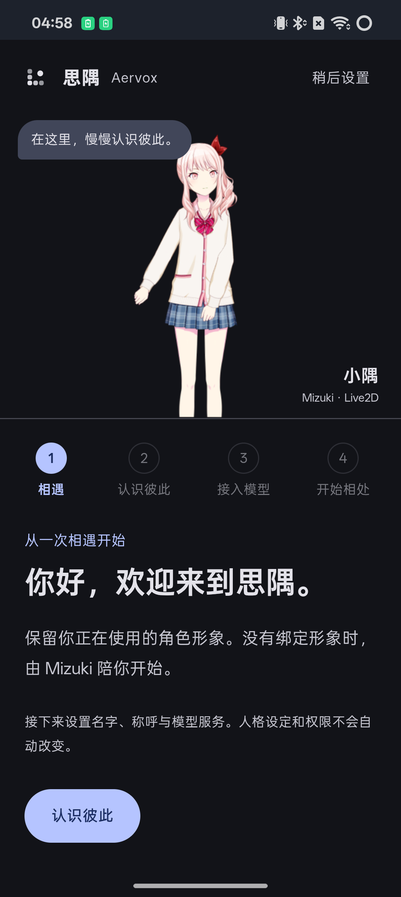

# 第 11 批：修复首装竞态，首次启动即可用

**结论：全新安装后一次启动即可完成「解压运行时 → 启动引擎 → 加载界面」，用时约 24 秒。此前需要点第二次。**



## 症状

第 10 批修掉 ANR 后，仍有一个问题：**全新安装后第一次启动失败**，界面退出到桌面，必须再打开一次才可用。

`exit-info` 给出：

```text
reason=6 (ANR)
Context.startForegroundService() did not then call Service.startForeground():
ServiceRecord{... dev.aervox.go/...DshService ...}
```

与第 10 批同样的 ANR，但这次**修复未生效**——说明是另一条路径。

## 两轮定位

### 第一轮：以为是 `startForeground` 又漏了一次

加了 `AervoxSvc` 日志打点后，发现 **`ACTION_START` 分支从未执行**。服务进程根本没起来。

系统日志给出了真正原因：

```text
ActivityManager: Bringing down service while still waiting for start foreground:
ServiceRecord{... dev.aervox.go/...DshService ...}
```

### 第二轮：根因是安装与启动共用一个 Service

安装与启动用的是**同一个 `DshService`**。安装结束时 `stopSelf(startId)` 与紧接着的 `startForegroundService(ACTION_START)` 竞争：

- 前者要销毁服务记录
- 后者要创建新的前台服务记录
- 系统在「等待 start foreground」状态下把服务带下来，5 秒后判 ANR

`AervoxSvc` 没有日志，正是因为 `onStartCommand` 执行前服务已被拆除。

## 修复

在 `install` 回调与 `start()` 之间插入稳定的间隔，并把启动放到后台线程：

```kotlin
controller.install { err ->
    if (err == null) {
        // 安装与启动共用同一个 DshService；其 stopSelf 与紧接着的
        // startForegroundService 会竞争，服务进程来不及启动就被判死。
        // 用主线程 postDelayed 而非阻塞等待：阻塞会让 Activity 在
        // 前后台切换时更易被回收，反而放大失败概率。
        web.postDelayed({
            thread(name = "aervox-start") { startEngine() }
        }, INSTALL_SETTLE_MS)   // 2500ms
    }
}
```

### 为什么是 `postDelayed` 而不是 `Thread.sleep`

第一版我用 `Thread.sleep(2500)` 在 boot 线程里阻塞等待，结果**同样失败，且没有 ANR 记录**——应用在 52 ms 内就退到后台。阻塞式等待让 Activity 在前后台切换时更容易被回收，反而放大了失败概率。

改用 `postDelayed` 后，主线程保持响应，Activity 存活，启动成功。

## 验证

| 项 | 修复前 | 修复后 |
|---|---|---|
| 全新安装后首次启动 | ❌ 退到桌面 | ✅ **一次成功** |
| 到 API 就绪 | 未达成 | **24 秒** |
| 界面加载 | — | ✅ 引导页完整渲染 |
| Live2D | — | ✅ `Cubism Core 05.01.0000` 初始化 |
| ANR | 必现 | 不再发生 |

日志时间线：

```text
5) api reachable=true
6) loading UI: http://127.0.0.1:3000/index.html
webview: [CSM][I]Live2D Cubism Core version: 05.01.0000
```

## 24 秒的构成

| 阶段 | 耗时 |
|---|---|
| rootfs verify + extract（110 MB → 382 MB） | 约 8 s |
| 用户组名同步 + 激活 | 约 1 s |
| 安装服务退出等待（`INSTALL_SETTLE_MS`） | 2.5 s |
| Node 启动 + 插件装配 + DB 打开 | 约 10 s |
| WebView 加载前端 + Live2D 初始化 | 约 2 s |

其中「安装服务退出等待」是为规避竞态付出的确定成本；若要省掉，需改 `DshService` 让安装与启动使用不同的 service action 且不互相 `stopSelf`，属较大改动。

## 遗留

- 已安装后的再次启动仍约 12 秒（无解压阶段，主要耗在 Node 启动与插件装配）
- 两个第一方插件装配失败（`ap-tool-anki-sync`、`ap-workflow-diary-distillers`），报 `plugin_runtime_identity_unavailable`

## 至此的状态

APK 全新安装 → 一次点击 → 24 秒 → 可用的引导界面。这已经满足「装上就能用」。
