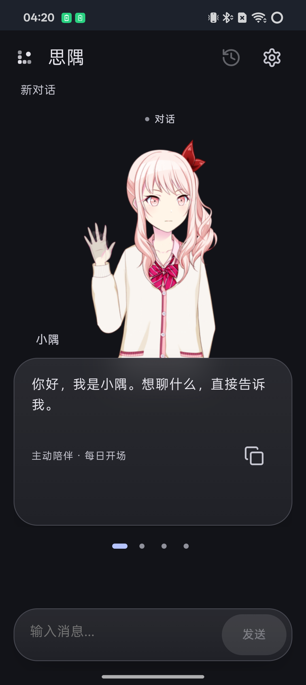

# 第 8 批：对齐主仓固定资产策略

**结论：aervox-go 的 WebView 已对齐 Aervox 主仓 `NativeAssetWebViewHost` 的固定资产策略，界面功能不受影响。**

## 为什么做这一批

主仓手机端（`apps/web/src/mobile/native-runtime.ts` 与 `NativeAssetWebViewHost`）有明确约束：

> 默认独立入口只加载 APK 内第一方脚本，禁止外部脚本、网络页面和 Service Worker。

此前的 aervox-go 只做到「前端无 CDN」（第 7 批），但 WebView 本身仍是宽松默认值：可导航到任意站点、Service Worker 未禁、权限请求未拒。本批补齐。

## 对齐项

| 项 | 主仓做法 | aervox-go 实现 |
|---|---|---|
| Service Worker | `blockNetworkLoads` + 拦截器全部返回空 | 同，并返回 403 |
| 外部域资源 | 由 Profile 阻断网络 | 拦截器对非 loopback 请求返回 403 |
| 页面导航 | — | `shouldOverrideUrlLoading` 拒绝非 `127.0.0.1:PORT` |
| 权限请求 | `onPermissionRequest` → deny | 同 |
| 地理定位 | 回调 false | 同 |
| 混合内容 | `MIXED_CONTENT_NEVER_ALLOW` | 同 |
| 文件访问 | 全关 | 同 |
| 下载 | `setDownloadListener` 退休 | 拒绝并留日志 |
| 表单/密码保存 | 关 | 同 |
| 多窗口/弹窗 | 关 | 同 |
| 缓存 | `LOAD_NO_CACHE` | 同 |

## 与主仓的差异（有意保留）

| 项 | 主仓 | aervox-go | 原因 |
|---|---|---|---|
| `MULTI_PROFILE` | 强制要求，用独立 Profile | 未使用 | 需要 `WebViewFeature` 判断与 Profile 生命周期管理，属后续工作 |
| `domStorageEnabled` | `false` | `true` | 前端需要 localStorage 保存主题与草稿；主仓手机端把偏好存原生 |
| `blockNetworkLoads` | `true` | `false` | 需访问 loopback API；外部域由拦截器兜底 |

`domStorageEnabled` 这一项是**真实的行为差异**，不是配置疏漏：aervox-go 复用的是主仓为浏览器设计的 Vue 前端，它依赖 localStorage。若将来要严格对齐，需把这些偏好改存原生（对齐主仓的 `NativePreferences`）。

## 验证

| 项 | 结果 |
|---|---|
| 界面渲染 | ✅ 角色、对话卡、四卡导航、输入栏正常 |
| Live2D 动画 | ✅ 加载 `w-normal-pose04.motion3.json` 等动作 |
| 静态资源提供 | ✅ `intercept asset: ... -> true` |
| 外部请求 | ✅ **0 次**（前端已无外部依赖） |
| 导航拦截 | ✅ 未触发（无越界尝试） |
| 权限请求 | ✅ 未触发 |

**关键**：拦截计数为 0，说明加固策略与现有前端完全兼容——没有为了合规而破坏功能。

## 仍未对齐

- `MULTI_PROFILE` 独立 Profile 与生命周期管理
- 偏好存储从 localStorage 迁到原生（对齐后的前置）
- 消息通道（`NativeMessageChannel` 等价物）：dsh-Go 用 `WebViewCompat.addWebMessageListener`，本仓未接入

## 下一步

1. 配置模型跑通真实对话（需密钥）
2. 资产瘦身（APK 422 MB）
3. 上述三项剩余对齐
