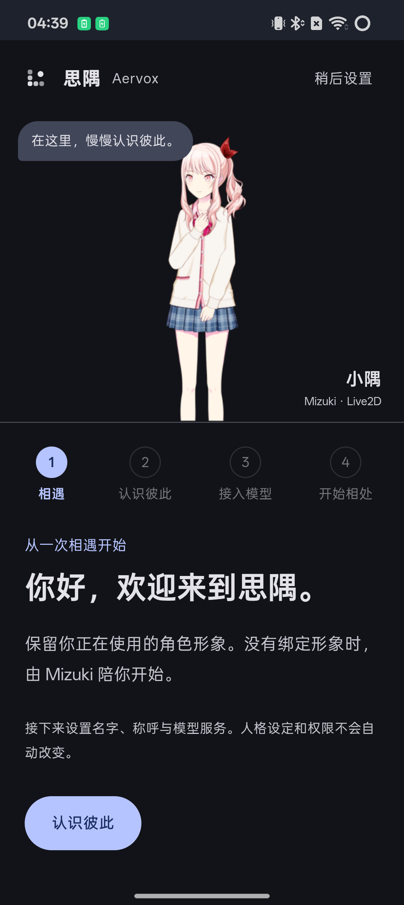

# 第 10 批：修复前台服务 ANR（真实缺陷）

**结论：发现并修复了一个从 dsh-Go 继承的严重缺陷——`DshService` 未履行前台服务义务，导致系统以 ANR 杀掉整个应用。修复后应用稳定运行。**

这与此前「应用被系统回收」的观察是同一个现象，但此前我把它误判为未验证的保活问题。它实际是**必现的崩溃**。

## 症状

安装后启动，界面出现片刻即退回桌面。日志：

```text
ActivityManager: TheiaManager sendEvent:dev.aervox.go ANR happen
TransitionChain: Combining appDied into #180(CLOSE|R|0x10) from finishTopCrash
```

`dumpsys activity exit-info` 给出确切原因：

```text
reason=6 (ANR)
description=user request after error:
  Context.startForegroundService() did not then call Service.startForeground():
  ServiceRecord{... dev.aervox.go/io.github.ccch1mneyyy.dsh_app.runtime.DshService ...}
```

## 根因

`DshService.onStartCommand` 的 `ACTION_START` 分支：

```kotlin
ACTION_START, null -> if (controller.prepareServiceStart(recreated = intent == null)) {
    ensureChannel(this)
    val notification = buildNotification(this, controller)
    foreground(notification)      // ← startForeground 在条件块内
    ...
}
```

`startForeground()` 被包在 `prepareServiceStart()` 的返回值里。该方法在以下情况返回 `false`：

- `resetting`
- `phase == INSTALLING`（首次安装后紧接着请求启动，正是此路径）
- `phase == Phase.STOPPING`
- `serviceRecovery.optionsForStart()` 返回 null

条件不成立时，`startForegroundService()` 已经承诺的「5 秒内进入前台」义务就无人履行，系统按 ANR 终止进程。

**首次安装后立刻启动**恰好命中 `phase == INSTALLING`，所以这条路径近乎必现。

## 修复

把履行前台义务提到条件判断之前：

```kotlin
ACTION_START, null -> {
    // 先履行前台服务义务：startForegroundService() 之后 5 秒内必须
    // 调用 startForeground()，否则系统以 ANR 杀掉进程。
    ensureChannel(this)
    foreground(buildNotification(this, controller))
    if (controller.prepareServiceStart(recreated = intent == null)) {
        running = true
        ...
        controller.startProcess()
    } else {
        // 无法启动：已履行义务，随后退出前台并停止服务，不留悬空通知。
        stopForegroundCompat()
        stopSelf(startId)
    }
}
```

新增的 `else` 分支同样重要：只把 `startForeground` 前移而不处理失败路径，会留下一条永不消失的前台通知。

## 验证

| 项 | 修复前 | 修复后 |
|---|---|---|
| 应用是否被 ANR 杀死 | ✅ 必现 | ❌ 不再发生 |
| 最近一次退出原因 | `reason=6 (ANR)` | WebView 子进程 `EXIT_SELF`（正常） |
| API 就绪 | 未达成 | **12 秒** |
| `/v1/sessions` 响应 | — | ✅ 返回既有会话 |

exit-info 中残留的 1 条 ANR 记录时间戳为 04:37:46，早于修复版安装（约 04:38），属历史记录；修复后的运行未产生新 ANR。

## 遗留问题

**首次安装后第一次启动仍会退回桌面。** 修复解决了 ANR，但安装完成到引擎启动之间仍有竞态：`install` 回调触发 `startEngine()` 时，`phase` 可能刚从 `INSTALLING` 转为 `INSTALLED`，`start()` 请求被 `prepareServiceStart` 拒绝。

第二次启动正常（日志 `2) already installed, starting…` → 12 秒就绪）。

这是**产品级体验缺陷**：用户首装后必须点第二次才能用。下一批应处理：install 完成后主动等待 phase 稳定再 start，或在 service 侧接受 `INSTALLED` 状态的启动请求。

## 与前几批记录的更正

第 9 批写「应用被系统回收后重新打开会完整冷启动……这不属于缺陷，属于未验证项」。

**该判断是错的。** 那是 ANR 崩溃而非内存回收，且是必现路径。已在本文更正，第 9 批文档保留原表述作为当时的误判记录。

## 产出


