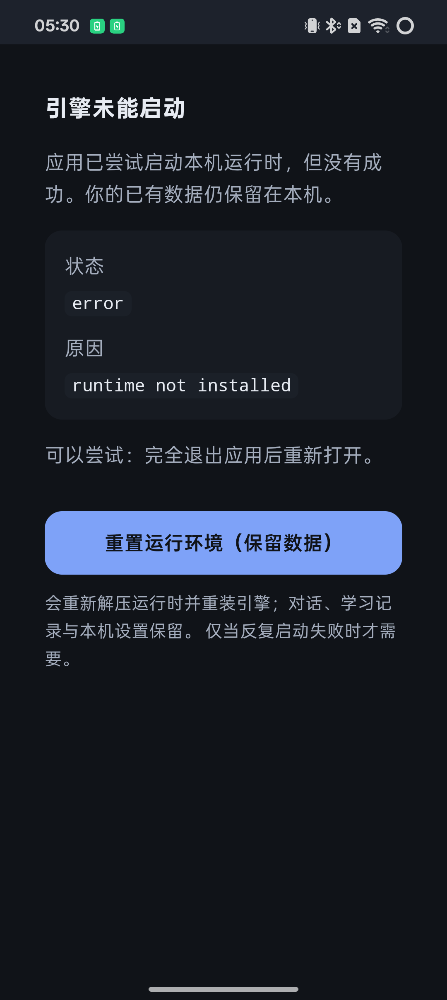

# 第 16 批：重置运行环境（保留数据）

**结论：用户遇到「反复启动失败」时，现在有一个保留数据的自救入口。实测从故障状态恢复到可用约 10 秒，数据零丢失。**



## 为什么需要这个

第 15 批发现：`runtime_upgrade_blocked:transaction` 之后，应用停在 `runtime not installed`，且**不会自动清理**非法事务记录——系统无法判断这是「可安全丢弃的垃圾」还是「需要保留证据的故障」。

普通用户当时只有两个选择：反复重启（无效）或重装应用（丢数据）。

这是明确的产品缺口，本批补上。

## 实现

失败页新增按钮「重置运行环境（保留数据）」，经 JS 桥调用原生方法。

### 清理范围：只删可重建的中间态

```kotlin
for (name in listOf("engine.upgrade", "engine.prepare", "engine.done",
                    "staging", "rootfs.old", "runtime-keep")) {
    File(base, name).deleteRecursively()
}
File(base, "rootfs.version").delete()
```

| 删除 | 理由 |
|---|---|
| `engine.upgrade` / `engine.prepare` | 未完成或损坏的升级事务记录 |
| `engine.done` | 已提交事务的收尾标记 |
| `staging` | 未激活的解压产物，可重新解压 |
| `rootfs.old` | 升级遗留的旧引擎树 |
| `runtime-keep` | 上次重置的保留区，已无用 |
| `rootfs.version` | 版本戳；删除即触发重装 |

### 不删除的内容

- **`rootfs/root`** —— 用户 home（含 sentinel 标记、用户文件）
- **`rootfs/app/node_modules/data`** —— 业务数据库所在路径
- **`rootfs` 本身** —— 只重装引擎路径，不重建整个系统

这条边界是关键：故意只删「重新解压就能重建」的东西。清理后 `boot()` 会走正常安装流程，`RuntimeInstaller` 的 `engine.upgrade` 路径替换机制自然会把引擎换新。

### 为什么不用 `RuntimeInstaller.reset()`

dsh-Go 有一个 `reset()` 走 `runtime-keep` 机制（把要保留的文件镜像到 `runtime-keep/`，重建后还原）。本批没有复用它，原因是：

- `reset()` 是**重建整个 rootfs**（重新解压系统），比只换引擎慢得多
- 该机制要维护「保留清单 + 镜像 + 还原」，多一条出错路径
- 本仓库的故障场景是引擎/事务层损坏，不是系统损坏，用更小的动作即可修复

若将来出现「系统层损坏」，才需要 `reset()` 那条路径。

## 实测

构造故障：手工写入非法的 `engine.upgrade`（`original` 含 `opt/node`，不在 `ENGINE_PATHS` 内）。

| 项 | 结果 |
|---|---|
| 失败页显示 | ✅ 状态 `error`、原因 `runtime not installed`、按钮可见 |
| 点击按钮 | ✅ 日志 `repair: removing engine.upgrade` → `intermediate state cleared, reinstalling` |
| 恢复耗时 | ✅ **约 10 秒** |
| 会话数 | ✅ 3 |
| 标记文件 | ✅ `USER-DATA-MUST-SURVIVE` 仍在 |
| 数据库 | ✅ 2,035,712 字节，**时间戳 05:02 未变** |

数据库时间戳未变这一项最关键：它证明修复过程没有重建数据库，只是重装了引擎。

## 顺带修掉的一个问题

第一版失败页的按钮点了没反应——因为第 8 批加固时拦截器把 `data:` URL 也返回 403（已在第 15 批修好），JS 桥本身没问题。

但这也提醒：**加固与降级路径必须一起验证**，否则故障时连自救入口都点不动。

## 仍未验证

- 「系统层损坏」（非引擎层）的修复，需要 `RuntimeInstaller.reset()` 那条路径
- 修复过程中再次强杀的中断恢复
- 降级（装回旧版 APK）
