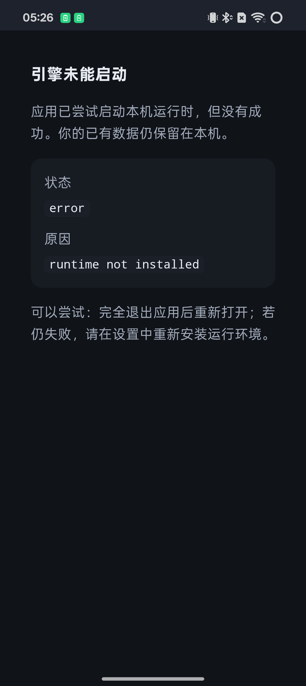

# 第 15 批：升级中断恢复与可见失败页

**两个结论：**

1. **升级中断后用户数据无损，重启即可恢复。** 解压阶段强杀、非法事务状态两种情形都验证过。
2. **修复了一个此前被掩盖的体验缺陷**：引擎起不来时界面是空白，用户不知道发生了什么。现在有可见的失败页。



## 一、解压阶段强杀

方法：删除 `rootfs.version` 触发升级，在解压进行到约 3 秒时 `am force-stop`。

| 项 | 结果 |
|---|---|
| 中断后目录状态 | `rootfs` + `rootfs.version` 均在，无残留 `staging` |
| 标记文件 | ✅ 完好 |
| 数据库 | ✅ 2,035,712 字节，时间戳未变 |
| 重启恢复 | ✅ 14 秒 |
| 会话数 | ✅ 3 |

解压是「先写 staging、再整体激活」，中断只会丢掉 staging，不影响已安装的 rootfs。这是安全的设计。

## 二、引擎替换阶段强杀

这一阶段太快（升级总耗时 1 秒），无法用定时强杀精确命中。改为**手工构造中断状态**：

```sh
mkdir -p engine.upgrade/{new,old}
echo -n "aervox-r1" > engine.upgrade/version
printf "opt/node\napp\netc/dsh-app\n" > engine.upgrade/original
```

`recover()` 会校验 `original` 的每一行都必须属于 `ENGINE_PATHS`；我构造的路径不在其中，于是得到：

```text
[dsh-app] install failed: runtime_upgrade_blocked:transaction
```

**这是期望行为**：系统拒绝了一个不合法的事务记录，而不是盲目按它恢复。数据完好。

## 三、发现并修复的体验缺陷

构造非法事务后，界面是**纯黑**，用户完全不知道发生了什么。

原因是我在第 11 批加的启动兜底逻辑只做了 `Log.w(TAG, "engine still not up after retries")`，然后就没有下文。

### 修复：可见失败页

```kotlin
Log.w(TAG, "engine still not up after retries")
val st = controller.status()
runOnUiThread { showFailure(st) }
```

失败页展示状态、原因与可操作的下一步，并明确告知「已有数据仍保留在本机」。

### 修复过程中踩到的第二个问题

第一版失败页仍显示浏览器默认错误：

```text
网页无法打开
位于 data:text/html;charset=utf-8;base64 的网页无法加载
net::ERR_HTTP_RESPONSE_CODE_FAILURE
```

原因是我在第 8 批加固时，拦截器把**所有非 loopback 请求**都返回 403——`data:` URL 也被算作非 loopback，于是应用自己渲染的降级页被自己的拦截器拦掉了。

修复：放行 `data:` 与 `about:`。

```kotlin
// data:/about: 是应用自绘的降级页与空白页，不属于外部网络资源。
if (raw.startsWith("data:") || raw.startsWith("about:")) return null
```

这个缺陷值得记录：**加固策略如果没有覆盖「应用自身的内部页面」，会把降级路径也一起切断**，导致故障时用户看到的是浏览器的英文错误而非产品的说明。

## 四、非法事务后的恢复

`runtime_upgrade_blocked:transaction` 会让应用停在 `runtime not installed` 状态，且**不会自动清理**非法事务记录——因为它无法判断这是「可安全丢弃的垃圾」还是「需要保留证据的故障」。

手工删除 `engine.upgrade` 后重启，14 秒恢复正常，3 个会话完整。

**这暴露一个产品缺口**：普通用户没有「清理损坏的升级记录」入口。当前只能重新安装应用（会丢数据）或依赖后续版本修复。

建议的改进方向：在失败页提供「重置运行环境（保留数据）」按钮，只删 `engine.upgrade` 与 `staging`，不动 `rootfs`。

## 验证汇总

| 场景 | 数据 | 可恢复性 |
|---|---|---|
| 升级成功 | ✅ 完整 | — |
| 解压阶段强杀 | ✅ 完整 | ✅ 重启自动恢复 |
| 非法事务（手工构造） | ✅ 完整 | ⚠️ 需手工清理 |
| 清理后重启 | ✅ 完整 | ✅ 14 秒 |

所有场景下用户数据均未丢失。**失败是安全的**这一判断在升级路径上也成立。

## 仍未验证

- 引擎替换阶段（`engine.upgrade` 已写入、部分路径已替换）的真实中断
- 降级（装回旧版 APK）
- 跨 `baseId` 升级
