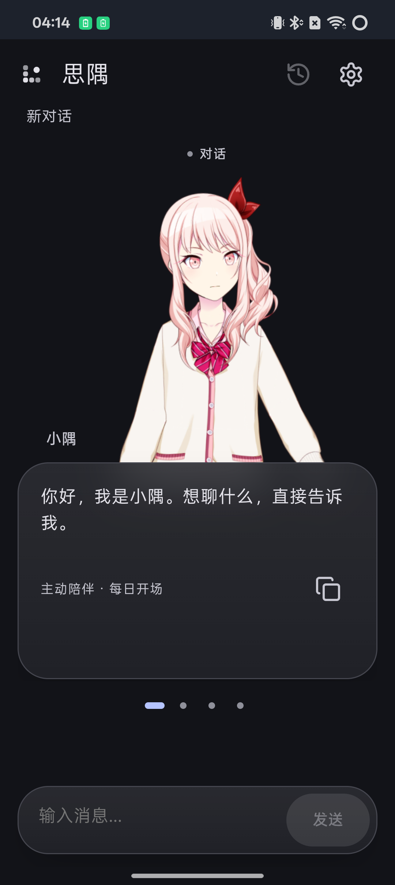
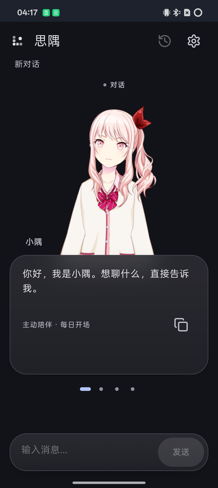

# 第 7 批：Vue 前端接入 WebView，界面完整运行

**结论：Aervox 的 Vue 前端已打包进 APK，由 WebView 加载，界面完整可用。** 角色渲染、对话卡、四卡导航、底部输入栏均正常。



## 做法

1. 用主仓的 mobile 构建产出前端：`pnpm --filter @aervox/mobile build`
2. 产物（74 MB）放入 `runtime/out/arm64-v8a/assets/web`
3. 新增 `WebAssetHandler`：从 `assets/web/` 提供静态资源，在 `shouldInterceptRequest` 中拦截
4. `MainActivity` 在 API 就绪后加载 `http://127.0.0.1:3000/index.html`

## 关键决策：同源，而不是自造域名

初版用 `https://aervox.local` 作为固定 origin，前端加载成功但所有 API 请求被拒：

```text
Access to fetch at 'http://127.0.0.1:3000/v1/personas' from origin
'https://aervox.local' has been blocked
```

原因在 host-runtime 的 CORS 白名单 `isLocalBrowserOrigin()`：它只接受 **loopback 主机名**（`localhost`、`127.x`、`::1`），自造域名不在其列。

**解法**：把 WebView 的 origin 设为 API 自身的 `http://127.0.0.1:3000`，实现同源。拦截器只在「同源且非 `/v1/` 前缀」时提供静态资源，API 请求照常走真实服务端。

这比放宽服务端 CORS 更安全：没有扩大任何来源许可。

## 与主仓 fixed-asset 策略的差异

主仓的手机端（`NativeAssetWebViewHost`）要求「只加载 APK 内第一方脚本，禁止外部脚本、网络页面和 Service Worker」。本批**尚未对齐**该策略：

| 项 | 现状 | 需要的处理 |
|---|---|---|
| Service Worker | 未显式禁用 | 需 `ServiceWorkerController` 全拦截 |
| 外部导航 | 未拦截 | 需在 `shouldOverrideUrlLoading` 拒绝非本机来源 |
| CDN 脚本 | `index.html` 仍引用 cubism.live2d.com 与 jsdelivr | **需改为本地制品**，否则离线不可用且违反策略 |

最后一项是明确的缺陷，见下节。

## 已知缺陷

### 1. 前端引用两个 CDN 脚本 —— **已修复**

初版 `apps/web/dist/index.html` 含：

```html
<script src="https://cubism.live2d.com/sdk-web/cubismcore/live2dcubismcore.min.js"></script>
<script src="https://cdn.jsdelivr.net/gh/dylanNew/live2d/webgl/Live2D/lib/live2d.min.js"></script>
```

联网时角色能显示，但违反固定资产策略，离线必失效。

**修复**：改为主仓已有的固定制品 `apps/web/public/vendor/live2dcubismcore.min.js`：

```html
<script src="/vendor/live2dcubismcore.min.js"></script>
```

该文件 207155 字节，SHA-256 `25ae938cb4fe282ce189b357bcc97e603d1e1f7ec78bf04150d401c23cdc792f`，与 `apps/mobile/README.md` 记录的固定值一致（构建产物中已复核）。

同时**移除了 Cubism 2 的 `live2d.min.js`**：项目只引用
`@sekai-world/pixi-live2d-display-mulmotion/cubism4` 入口，Cubism 2 无消费者。
这是一个本地无引用的外部脚本，不是功能依赖。

**离线验证**：关闭 Wi-Fi 与移动数据（`ping 8.8.8.8` 返回 `Network is unreachable`）后冷启动，界面与 Live2D 角色正常渲染：



### 2. 端口与清单不一致

清单的 `{PORT}` 占位符未生效，API 实际监听 Aervox 默认的 3000。`MainActivity.PORT` 已对齐 3000，但清单里的 `PORT` 环境变量仍是 3080，属遗留冗余。

### 3. Kotlin 注释里的词法陷阱

写文档注释时把 `/v1/*` 写进去，`/*` 会被词法器当作注释开始，导致「Unclosed comment」编译错误。已改写为「/v1/ 前缀」。

## 验证状态

| 项 | 结果 |
|---|---|
| 前端在 WebView 中渲染 | ✅ |
| Live2D 角色加载与动画 | ✅ 连续加载动作文件 |
| 静态资源经拦截器提供 | ✅ 日志 `intercept asset: ... -> true` |
| API 同源访问 | ✅ |
| 四卡导航、输入栏 | ✅ 截图可见 |
| **无 CDN 依赖** | ✅ 仅 `/vendor/live2dcubismcore.min.js` |
| **离线冷启动** | ✅ 断网后界面与角色正常 |

## 未验证

- 真实对话（需配置模型）
- SSE 流式在 WebView 内的表现
- 冷启动耗时
- 后台保活与进程回收恢复
- 运行时升级保留数据

## 下一步

1. 配置模型并跑通一次真实对话（含 SSE）
2. 对齐 fixed-asset 策略的剩余两项：禁 Service Worker、拒绝外部导航
3. 资产瘦身（当前 APK 422 MB）
