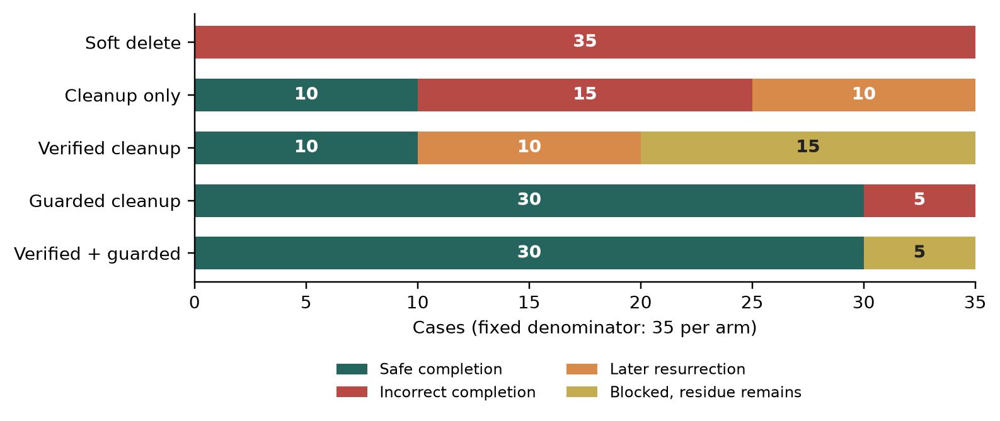
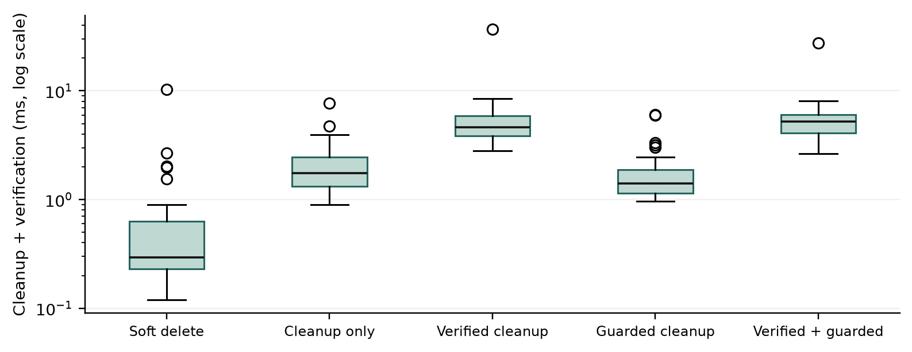

# Logical Deletion Quality for Asynchronously Derived Memory: A SQLite Engineering Case Study of Write Paths, Completion Checks, and Protocol Evolution

Engineering case study · Aervox-harness

## Abstract

A deletion flag does not establish that derived memory content has been removed, and cleanup does not prevent a worker from persisting information fetched earlier. We study logical deletion in a local, single-user SQLite memory subsystem. Five component ablations cover ten named write entrypoints at three relative positions and five cleanup omissions, yielding 175 predetermined cases. Cleanup alone produces 15 incorrect completions and ten resurrections. Verification without guards blocks 15 cases but still permits ten resurrections; guards without verification miss five omissions. Their combination yields 30 safe completions and five correctly blocked omissions, with no incorrect completion or resurrection in the selected matrix. An API inventory exposes alternative provenance writes, and versioned evidence selection addresses completed requests that predate stronger checks. Twelve production-path SIGKILL probes and five cross-process worker schedules preserve retained data and reach clean completion after retry. Separate timing and three synthetic size profiles describe local operation costs. The contribution is a bounded engineering case concerning write coverage, failure text, and verification-contract evolution. It does not establish general concurrency correctness, model unlearning, backup erasure, or secure physical deletion.

Keywords: persistent memory; logical deletion; software quality; SQLite; fault injection; reproducibility

## 1. Introduction

Applications with persistent memory often derive several stored objects from a user fact. The source text may appear in the main record and its revisions, retrieval indexes and vectors, compressed summaries, queued event payloads, and diagnostic messages. These objects do not necessarily share the same lifecycle. A worker may fetch source content before a deletion request and persist either a result or an exception message after cleanup has completed.

Deletion quality therefore has two temporal requirements. At declared completion, the logical stores within the request's scope should contain no prohibited residue. After completion, an outstanding producer should not restore that residue through a supported write path. Affected-row counts from cleanup do not establish the first requirement. A source check performed separately from a later write does not establish the second: deletion may occur between the check and the write, and error handling may bypass guards on the normal result path.

This case study treats deletion as a software-quality concern that evolves with write interfaces and checking rules. We ask four research questions. RQ1: Which failure modes are constrained by cleanup, write guards, and completion checks, and can verification replace guards? RQ2: Which content-bearing or reference-restoring entrypoints are missed by coverage organized only around destination stores? RQ3: How should earlier completion evidence be invalidated and selected for rechecking when the verification contract becomes stronger? RQ4: What recovery and cost evidence can selected production schedules, process termination boundaries, and synthetic sizes establish for this implementation?

The study offers three connected implementation lessons. First, failure messages, revisions, evidence ranges, and current-revision links belong in the write inventory; a table inventory alone is insufficient. Second, completion checking observes current state, whereas guards constrain later persistence. A successful check can precede resurrection. Third, evidence accepted under an earlier contract does not establish compliance with a stronger one. Evidence consumers and work selection must evolve with the checker. We connect these lessons to component ablation, a separate SQL observer, named repository APIs, and explicit execution barriers.

These are applications of established deletion and software-testing principles. The study does not introduce a new definition of erasure, concurrency algorithm, or general proof framework. Its transferable output is a set of review questions, an explicit write inventory, and a reproducible experimental structure. Whether these lessons transfer to other implementations remains an external-validity question.

## 2. Related work and positioning

### 2.1 Deletion correctness and provenance

Database provenance distinguishes explanations for an output's existence from the origins of its values [1]. Our implementation uses recorded source relationships to locate deletion targets. It neither contributes a provenance theory nor assumes that recorded edges represent all semantic influence.

DELF is the closest systems precedent [7]. It translates deletion annotations on data types into asynchronous operations and checks specifications statically and dynamically. Our contribution is narrower: failure writes, alternative provenance APIs, and evolving completion evidence in one local memory subsystem. We do not implement or execute DELF and make no comparative effectiveness or performance claim.

Athanassoulis et al. distinguish application-level requirements from persistent deletion at the storage layer [8]. P2E2 constrains inference from dependencies after erasure [9]. These distinctions prevent a residual-row test from being interpreted as physical erasure or an inference guarantee. Our measurements address only the declared logical stores and named write interfaces. Garg et al. formalize broader deletion guarantees [2]; our application evidence is not a cryptographic proof or an indistinguishability result.

| Work | Main concern | Relationship to this case |
| --- | --- | --- |
| DELF [7] | Annotations, asynchronous deletion, specification checking | Direct precedent; this case reports specific write paths and evidence evolution |
| Deletion-compliant data systems [8] | Application and storage requirements | Our observer covers application-queryable state |
| P2E2 [9] | Inference under data dependencies | Inference is not measured here |
| This case | Write coverage, failure text, checker versions, and recovery | Evidence from one repository, without an external framework comparison |

### 2.2 Controlled testing and memory forgetting

CHESS uses controlled scheduling to expose and reproduce concurrency faults [3]. Bounded black-box crash testing uses limited workloads and injected failures to find consistency defects [4]. We use explicit schedules and barriers without enumerating all reachable states. The ordered matrix, production worker schedules, and termination probes have different experimental units and are not pooled into a reliability percentage.

Yao et al. study execution-state unlearning through restoration and replay [5]. MemLineage uses provenance and derivation relationships to constrain sensitive actions [6]. The former relies on assumptions including deterministic transitions and a restorable environment; the latter depends on recorded parent edges and attribution thresholds. We do not evaluate models, KV caches, or action authorization. Both 2026 references are cited as verified arXiv version 1 preprints, not as peer-reviewed publications.

## 3. System scope and completion criteria

### 3.1 Objects and logical stores

The subject is the Memory repository slice of Aervox-harness, a local, single-user SQLite application. Each main-matrix database contains a deletion target, `target`, and a retained object, `keep`. Cleanup preserves an identity tombstone while clearing content and designated references. Shared facts and projections owned by another lifecycle require their owner's handling. The production deletion component rejects unsupported targets; the experiment does not bypass that boundary.

| Logical store | Required post-cleanup state |
| --- | --- |
| Main record | Exactly one deleted tombstone; empty content; cleared keywords, source, current revision and parent references; invalidated verification state |
| Revisions | Empty content in every target revision |
| Evidence | Tombstoned evidence for all target revisions, with source ranges cleared |
| Full-text index | No target entry |
| Vectors | No target embedding |
| Compaction summaries | Null summary and tombstoned state |
| Audit events | Null reason text in target events |
| Outbox | Only allowed identity fields and a Boolean deletion flag; published state; null error text |

Identity strings are retained metadata, with the explicit assumption that they do not contain source text. An Outbox `snapshotId` must be a string or null. The observer compares complete rows for `keep` across all eight stores. It also keeps fixture-owned Outbox event identities outside the database, so a malformed payload cannot escape observation merely by losing `memoryId`. This measurement facility is not an independent provenance ledger in production.

### 3.2 Protocol and assumptions

A successful check by version v is denoted `checked(v)`. Its evidence must also be persisted before the corresponding completion is durable.

```text
live -> invalidated + cleaned -> checked(v) -> completed(v)
                  |                  |
                  +-- crash/retry ---+-- residue -> blocked -> clean/recheck
completed(old-v) -> selected-for-recheck -> checked(current-v)
late writer ------> source check + write in one atomic boundary
```

`clean()` invalidates the source and cleans this slice in one writer transaction. `verify()` reads the database afresh rather than interpreting affected-row counts. A worker persists target evidence before completing the request. A rejected check blocks completion. Cleanup commit, checking, target evidence, and request completion are separate interruption boundaries, so recovery must use durable state rather than a worker's memory of having finished.

The protocol has four assumptions. Every applicable persistence entrypoint must execute its guard. Source relationships must be complete, and identity metadata must not carry content. No other entrypoint may reactivate the retained identity. SQLite transactions must provide the required local write atomicity. Arbitrary raw SQL, plugins, external stores, and external effects are outside the declared write boundary. Shared projections belong to another lifecycle. Passing this slice cannot establish their deletion. The experiments check enumerated entrypoints and barriers, rather than proving that these assumptions hold permanently throughout the product.

### 3.3 Outcome definitions

Let C mean that completion was declared, R(t) be the residual-count vector over the eight stores, and K(t) mean that the retained snapshot is unchanged. We observe at completion, t_c, and after the prescribed late write, t_f.

- Incorrect completion: C is true and at least one component of R(t_c) is nonzero.
- Resurrection: C is true and R(t_c) is zero, but R(t_f) is nonzero.
- Safe completion: C is true, both residual vectors are zero, and K(t_f) is true.
- Blocked: verification refuses completion. Residue in an omission case remains present and is not counted as successful deletion.

These rules classify individual predetermined cases; they are not failure-probability estimates. Write rejection and completion rejection are also distinct: the former prevents persistence, while the latter prevents an inaccurate completion claim.

## 4. Implementation changes and coverage

### 4.1 Atomic write boundaries

Cleanup updates tombstones, revisions, evidence, summaries, and events; removes full-text entries and embeddings; and changes compaction Outbox events to terminal payloads without content. A guard must share an atomic boundary with persistence. A conditional SQL statement can include the source predicate in the modification itself. Provenance APIs needing multiple reads check the source and insert within one writer transaction. The vector adapter delegates to the guarded embedding repository. Rejection may be represented by an error, an empty update, or a skipped insertion. Database observations determine the experimental outcome.

The production verifier rereads all eight stores. The experimental SQL oracle does not invoke that verifier. Residue-injection controls check the observer's sensitivity. Both share the declared deletion scope and tombstone contract, so separate query implementations reduce known blind spots without creating an independent specification.

### 4.2 Failure writes and alternative provenance APIs

The earlier Outbox `markFailed` and `markDeadLetter` methods updated status and error text by event identity alone. After a worker cached source text and cleanup published an Outbox tombstone, a late exception could restore a failure or dead-letter state containing that text. The fix includes both an undeleted-event condition and the corresponding source's liveness in the actual update. The following schematic omits retry counters but preserves the relevant predicate:

```sql
UPDATE outbox_events
SET status = 'dead_letter', last_error = :error
WHERE id = :event_id
  AND (
    event_type != 'memory.compaction.requested'
    OR (
      json_extract(payload, '$.deleted') IS NOT 1
      AND EXISTS (
        SELECT 1 FROM memory_records
        WHERE memory_records.id = json_extract(outbox_events.payload, '$.memoryId')
          AND memory_records.is_deleted = 0
      )
    )
  );
```

The source lookup is correlated to the current event; another live memory cannot satisfy it. If the error update happens first, cleanup removes its content. If cleanup happens first, the predicate prevents the update. This two-order explanation applies only to entrypoints that execute that atomic condition.

A subsequent API inventory identified `recordMemoryEvent`, which writes to the same audit destination as a previously guarded method, and `appendMemoryRevision` and `createMemoryEvidence`, which can restore revision content and evidence ranges. Testing only the guarded `recordEvent` API had missed these paths. The revised APIs check the source and insert in one writer transaction. The conditional `setMemoryCurrentRevision` update requires both a live source and a revision belonging to that source. Deletion-flag updates are monotone, and the retained tombstone's primary key prevents recreation with the same identity.

| Matrix entrypoint | Destination | Guard or coverage |
| --- | --- | --- |
| `indexMemoryFts` | Full-text index | Conditional insertion; three positions |
| `insertBatch` | Embeddings | Source guard; three positions |
| `upsertMarker` | Summary | Source check in writer transaction; three positions |
| `recordEvent` | Audit reason | Source guard; three positions |
| `insertEvent` | Outbox | Compaction-source guard; three positions |
| `appendMemoryRevision` | Revision content | Source check and insert in one transaction; three positions |
| `createMemoryEvidence` | Evidence range | Source resolved through revision; one transaction; three positions |
| `recordMemoryEvent` | Audit reason | One guarded writer transaction; three positions |
| `setMemoryCurrentRevision` | Main-record link | Conditional update; three positions |
| Vector adapter `upsert` | Embeddings | Delegates to repository; three positions |

The two Outbox error methods have a separate old/new comparison. `createRecord` and `softDeleteRecord` have tombstone and monotonicity regressions, while `clean` is covered by the cleanup and omission matrix. Parent-bearing creation, edge evidence, and Skill candidates cross the shared-projection boundary; production rejection and boundary regressions apply rather than a claim of complete deletion by this slice. The inventory names repository APIs and the vector adapter, not arbitrary SQL or plugin code.

### 4.3 Stronger checking and older completion evidence

Earlier checking omitted some source references, summary state, and Outbox terminal state, and inspected only one content key. The strengthened verifier checks the complete tombstone shape, requires a JSON Boolean deletion flag, and rejects additional keys and nested `snapshotId` objects. Cleanup converts malformed snapshots to null.

A stronger query alone was insufficient while evidence still used `memory-local-v2`. Previously completed requests could bypass the stronger check. The revision centralizes `memory-local-v3` and makes the deletion gate, work selector, and evidence consumer recognize older, missing, or invalid evidence. The worker cleans and checks again; it does not relabel earlier evidence. A regression begins with completed v2 state and a residual payload, then checks gate closure, reselection, and fresh v3 completion. This synthetic upgrade test does not establish that any real user database has already been revalidated.

## 5. Method

### 5.1 Five arms and the ordered matrix

All arms share the fixture and predeclared manifest. Unguarded paths and cleanup omissions are experimental SQL mutations, not external systems or production operating modes.

| Arm | Invalidation and cleanup | Guarded writes | Completion check |
| --- | --- | --- | --- |
| soft-delete | Deletion flag only | No | No |
| cleanup-only | Cleanup | No | No |
| verified-cleanup | Cleanup | No | Yes |
| guarded-cleanup | Cleanup | Yes | No |
| verified-guarded | Cleanup | Yes | Yes |

Each of ten write entrypoints executes once before cleanup, after cleanup but before completion, and after completion. Five additional cases omit cleanup of one of the full-text, vector, summary, audit, and Outbox channels. This yields 35 cases per arm and 175 overall, with one execution per combination and an independent database per case. Late content derives from a payload cached before deletion. The current-revision case restores a reference rather than new text, but violates the same tombstone contract and retains its own writer identity.

The positions are arranged using awaited steps and do not depend on an accidental race. They do not exhaust transaction-internal interleavings or multi-connection contention. The additional `verified-cleanup` arm directly tests whether an accepted check can be followed by unguarded resurrection.

### 5.2 Observer controls

The oracle reads the eight stores at declared completion and after the final write, requires exactly one target tombstone, and compares the retained snapshot. Evidence lookup traverses every target revision. Separate sensitivity controls inject residue into each store. Additional revisions, lost source fields, malformed or extended payloads, nested snapshots, and corruption of retained evidence exercise known blind spots. These controls are not added to the main matrix denominator.

### 5.3 Timing and synthetic size

The primary microbenchmark repeats `fts:before-clean` 24 times per arm, yielding 120 timing rows. Each uses a new database file and connection in an already loaded process. Arm order rotates between repetitions. Timing includes cleanup and any verification, excluding initialization, fixture construction, late writes, and oracle queries. Each row retains completion and final observations so an incomplete operation cannot be silently treated as a successful deletion time. The flag-only baseline intentionally has incomplete deletion semantics.

`cleanup-only` and `guarded-cleanup` execute the same cleanup function within this interval. Their timing difference is not a guard-cost estimate. A supplementary live-source revision benchmark alternates a reconstructed legacy SELECT-plus-INSERT path and the production transaction path, 12 samples each. The latter includes JavaScript abstraction and transaction overhead; their difference does not isolate the predicate's cost.

Three synthetic size profiles each run in three fresh child processes, measuring cleanup and checking separately:

| Profile | Background main records | Target revisions | Configured content bytes |
| --- | --- | --- | --- |
| small | 10 | 1 | 128 |
| medium | 1,000 | 100 | 1,024 |
| large | 10,000 | 1,000 | 4,096 |

Each added target revision has one evidence row. Complete background main-record digests are compared before and after deletion. The profiles jointly change three factors and do not isolate their effects; vector and summary fanout do not scale proportionally. The content parameter applies to synthetic background rows and added revisions/evidence, rather than every field in the database. Fresh processes do not imply cold file-system caches. Primary timing quantiles use type 7 interpolation. With only three scale observations per profile, we report ranges and medians without significance tests.

### 5.4 Production workers and termination boundaries

The main report retains four old/new error-write probes for the two Outbox methods and two inherited termination probes at a manual transaction and a post-cleanup boundary. These are not substitutes for the new production probes.

The supplementary report kills execution after each of eight mutations inside the actual uncommitted `clean()` transaction. It also covers cleanup commit, immediately before and after target-evidence persistence, and request completion: 12 SIGKILL boundaries overall. An observation proxy pauses after the awaited database operation using IPC; it does not change production source or transaction boundaries. After receiving the named barrier, the parent kills and reopens the child database, then invokes the real deletion worker to check rollback, reselection, and idempotent recovery.

Five cross-process schedules execute production compaction and deletion cycles: deletion after event fetch, deletion after marker persistence, cleanup competing with a guard holding the writer lock, two workers caching the same event, and a late exception. Each schedule has an independent file database and connections. The duplicate-worker schedule starts two child processes. The lock schedule verifies a busy result before releasing and retrying; the others use explicit IPC barriers to order the operations. These are selected schedules, not a worker-count stress test or a power-loss simulation.

### 5.5 Evidence provenance

The schema 3 main report records all five arms, named entrypoints, exclusions, the current verifier, and raw case observations. A separate supplementary report records production termination, worker schedules, scale, and writer timings. Both record generation time, measured HEAD, working-tree state, and hashes of required source files, executable JavaScript, schemas, scripts, and toolchain inputs. The main report stores SQLite settings; scale observations additionally record engine, client, kernel, and file-system identifiers. Input hashes identify uncommitted patches that HEAD alone cannot describe.

Inputs are hashed again after measurement. Drift or read failures preserve raw evidence before failing. Validators recompute classifications and quantiles, check the full manifest and CSV consistency, and check supplementary barriers, process identities, and recovery conditions. An explicit source check distinguishes archived historical reports from reports matching the current build.

## 6. Results

### 6.1 Residue at completion and subsequent resurrection

| Arm | Cases | Completed | Incorrect | Resurrection | Safe | Blocked |
| --- | --- | --- | --- | --- | --- | --- |
| soft-delete | 35 | 35 | 35 | 0 | 0 | 0 |
| cleanup-only | 35 | 35 | 15 | 10 | 10 | 0 |
| verified-cleanup | 35 | 20 | 0 | 10 | 10 | 15 |
| guarded-cleanup | 35 | 35 | 5 | 0 | 30 | 0 |
| verified-guarded | 35 | 30 | 0 | 0 | 30 | 5 |



All 35 flag-only cases complete incorrectly. Cleanup alone removes the ten writes performed before cleanup, but ten writes before completion and five omissions produce 15 incorrect completions. Ten writes after completion cause resurrection. The added `verified-cleanup` arm blocks the 15 completion attempts with residue but still permits ten post-check resurrections. Completion verification therefore does not replace guards on later writes.

Guarded cleanup leaves no observed late-write residue, yet incorrectly completes all five omission cases. The combined mechanism blocks those five cases and safely completes the other 30. Final residual-case counts are 35, 25, 25, five, and five: verification refuses an inaccurate completion claim rather than removing omitted content. Retained objects are unchanged in all 175 cases, with no unhandled experimental errors. These results address RQ1. Distinct audit and vector entrypoints also show why one guarded method cannot stand in for an entire destination store, addressing the coverage aspect of RQ2.

### 6.2 Implementation defects and evolving evidence

Both reconstructed Outbox error methods restore error text after cleanup, changing status to `failed` or `dead_letter`. Both patched production methods preserve the `published` tombstone without residue. This 2/2 comparison covers two named methods rather than estimating a fault probability. The expanded matrix additionally covers revision content, evidence ranges, provenance audit, and reference restoration.

The v3 upgrade regression begins with completed requests carrying older evidence and a residual payload. It checks renewed gate closure, worker reselection, cleanup, and persistence of fresh evidence. The version constant is shared by the verifier, evidence consumer, and work selector, addressing RQ3 as an implementation change. These synthetic-state regressions do not establish revalidation of real user databases.

### 6.3 Production termination and worker schedules

| Production termination group | Probes | Reopened state and recovery |
| --- | --- | --- |
| After eight actual cleanup mutations, before commit | 8 | Complete target snapshot rolled back; one successful worker retry each |
| After cleanup commit, before target evidence, after target evidence | 3 | Clean state persisted; one successful worker retry each |
| After request completion | 1 | Clean and completed state persisted; no request recompletion needed |

All 12 probes reach their named barriers and terminate by SIGKILL. All eight uncommitted snapshots match the state before the transaction; the other four reopen clean. Every final state is clean, retained data is unchanged, and no request remains pending. The two inherited representative probes in the main report also pass, without adding distinct production boundaries.

All five cross-process schedules finish exactly one deletion request and pass the final oracle. The lock schedule observes a busy competing cleanup, then permits the production write to commit before retrying cleanup. Late workers in the other four schedules leave no content-bearing active summary; identity tombstones may remain. In the duplicate-worker schedule, both workers cache the earlier event, yet neither restores content after deletion. This addresses the recovery and contention part of RQ4 only at the stated boundaries.

### 6.4 Operation timing and synthetic profiles

The main report's timestamp is 18 October 2026, 02:05:15 Asia/Shanghai. The measured commit is `bd19a16c`, with uncommitted manuscript changes recorded in the report. Both reports cover 97 required inputs with unchanged before/after hashes. The machine uses Apple M5, macOS arm64, Node v24.21.0, libSQL client 0.14.0, SQLite 3.45.1, and Darwin 27.2.0; the file-system type identifier is 25. The observed connection returns `journal_mode=wal`, `synchronous=2`, `foreign_keys=1`, and `busy_timeout=0`. These are query observations, not inferred initialization settings.

Primary timing has n=24 per arm. Values are milliseconds rounded to three decimals; JSON retains the original precision.

| Arm | P25 | Median | P75 | P95 |
| --- | --- | --- | --- | --- |
| soft-delete | 0.230 | 0.294 | 0.630 | 2.589 |
| cleanup-only | 1.329 | 1.755 | 2.445 | 4.594 |
| verified-cleanup | 3.842 | 4.623 | 5.921 | 8.465 |
| guarded-cleanup | 1.142 | 1.406 | 1.874 | 5.546 |
| verified-guarded | 4.116 | 5.210 | 6.057 | 7.946 |



The combined mechanism's median is 5.210 ms in this small fixture, compared with 1.755 ms for cleanup alone. The interval includes checking but excludes late writes. Differences between verification arms do not estimate guard cost, since guarded writes occur outside the interval.

Each synthetic profile has three fresh-process observations. Ranges below are observed minima and maxima in milliseconds.

| Profile | Cleanup median | Cleanup range | Check median | Check range |
| --- | --- | --- | --- | --- |
| small | 2.194 | 1.895-3.770 | 3.221 | 2.725-5.064 |
| medium | 3.102 | 2.386-3.186 | 3.780 | 2.658-4.949 |
| large | 17.516 | 12.239-17.752 | 7.151 | 5.281-14.114 |

The nine observations use distinct processes and finish clean, with complete background main-record digests unchanged and retained objects intact. The large profile has 1,000 target revisions and a cleanup median of 17.516 ms. Since background size, revision count, and content length change together, the increase cannot be attributed to any single factor or used to fit a reliable scaling trend.

Separate live-source revision writes produce the following timings in milliseconds:

| Path | n | P25 | Median | P75 | P95 |
| --- | --- | --- | --- | --- | --- |
| legacy-select-insert | 12 | 0.296 | 0.335 | 0.398 | 0.458 |
| guarded-production | 12 | 0.422 | 0.624 | 0.743 | 2.053 |

All 24 writes actually persist. The production API median is 0.624 ms, versus 0.335 ms for the reconstructed legacy path. Different JavaScript and transaction paths are included; these are local API measurements, not isolated SQL-predicate overhead or end-to-end throughput. Cost evidence remains separate from correctness evidence and supports neither a significance claim nor a near-zero-cost claim.

## 7. Discussion and validity

### 7.1 Transferable review questions

Three reviews should remain separate. The inventory of stores to clean should be paired with an inventory of entrypoints that can persist content or restore prohibited references. Two methods targeting the same table may have different guards. Checking should observe both declared completion and the state following a prescribed late write, because a current-state check does not constrain later writes. Finally, a stronger verification contract requires coordinated changes to evidence, consumers, and work selection.

A version identifier does not create visibility. Missing source edges, undeclared tables, and identity strings containing text can still defeat the scope. Independent specifications, schema mutation, and replication in another implementation would strengthen the evidence. An empty query result cannot by itself establish that the query scope is complete.

### 7.2 Threats to validity

**Internal validity.** Unguarded paths and omissions are deliberate mutations, not a sample of naturally occurring production faults. The oracle and verifier share an object model and may share omissions. Sensitivity controls and complete retained snapshots address known blind spots only.

**Construct validity.** Safe completion and resurrection are logical predicates at finite observation times. Blocking is not successful deletion. Restoring a cleared reference also violates the tombstone contract; not every counted resurrection contains a newly written text string.

**External validity.** One repository, synthetic data, and named entrypoints do not represent multiple projects, synchronized devices, or complex shared graphs. No real model, user database, or external memory framework was evaluated. Shared-projection ownership and arbitrary SQL remain outside this slice.

**Timing and failure validity.** Three ordered positions, five production schedules, and named termination barriers do not exhaust execution states. SIGKILL leaves the operating system and storage stack running. IPC observation changes scheduling deliberately to reach boundaries and cannot estimate natural fault frequencies.

**Cost validity.** Primary timing excludes guarded writes, while supplementary writer timing includes the complete API path. Each size profile changes three factors and has only three observations. Growth in background records and target revisions does not cover all derivative fanout. Cache state, background load, and a single machine limit extrapolation.

### 7.3 Research materials and responsibility

All experiments create temporary databases and do not read real user content. Source, toolchain inputs, JSON/CSV, and generated figures accompany the study. Cross-machine timings need not be identical. Human authors must supply verified identities, affiliations, contribution statements, and any artifact DOI only when available. This manuscript is preparation material, not a claim of submission or acceptance. Reproduction, CI validation, PR integration, real-database revalidation, and publication require separate evidence.

## 8. Conclusion

This case separates local memory cleanup, controlled persistence, and completion checking, while treating checker evolution as a durable protocol concern. The entrypoint inventory exposes provenance and failure-text paths beyond ordinary derivative results. Verification without guards still permits ten resurrections; their combination yields 30 safe completions and five blocked omissions. Production termination and cross-process schedules extend the evidence beyond a small ordered fixture, without establishing general concurrency or cross-system guarantees. Further work should test the review method across implementations, complete provenance relationships, and shared-projection ownership, while evaluating logical deletion, physical erasure, and semantic unlearning separately.

## References

[1] Peter Buneman, Sanjeev Khanna, Wang-Chiew Tan. Why and Where: A Characterization of Data Provenance. ICDT 2001, LNCS 1973, pp. 316-330. Springer, 2001. DOI: [10.1007/3-540-44503-X_20](https://doi.org/10.1007/3-540-44503-X_20).

[2] Sanjam Garg, Shafi Goldwasser, Prashant Nalini Vasudevan. Formalizing Data Deletion in the Context of the Right to be Forgotten. Cryptology ePrint Archive, Paper 2020/254, 2020. The cited version is the ePrint revision. [Source](https://eprint.iacr.org/2020/254).

[3] Madanlal Musuvathi, Shaz Qadeer, Thomas Ball, Gerard Basler, Piramanayagam Arumuga Nainar, Iulian Neamtiu. Finding and Reproducing Heisenbugs in Concurrent Programs. 8th USENIX Symposium on Operating Systems Design and Implementation (OSDI 08), 2008. [Proceedings](https://www.usenix.org/conference/osdi-08/finding-and-reproducing-heisenbugs-concurrent-programs).

[4] Jayashree Mohan, Ashlie Martinez, Soujanya Ponnapalli, Pandian Raju, Vijay Chidambaram. Finding Crash-Consistency Bugs with Bounded Black-Box Crash Testing. 13th USENIX Symposium on Operating Systems Design and Implementation (OSDI 18), pp. 33-50, 2018. [Proceedings](https://www.usenix.org/conference/osdi18/presentation/mohan).

[5] Chao Yao, Yangbo Wei, Zhen Huang, Junhong Qian, Chenle Chen, Shaoqiang Lu, Chen Wu, Lei He. Forgetting Without Restarting: Execution-State Unlearning for Stateful LLM Agents. arXiv:2609.04875v1, 2026. Preprint, version 1. [Source](https://arxiv.org/abs/2609.04875v1).

[6] Ciyan Ouyang, Rui Hou. MemLineage: Lineage-Guided Enforcement for LLM Agent Memory. arXiv:2605.14421v1, 2026. Preprint, version 1. [Source](https://arxiv.org/abs/2605.14421v1).

[7] Katriel Cohn-Gordon, Georgios Damaskinos, Divino Neto, Joshi Cordova, Benoît Reitz, Benjamin Strahs, Daniel Obenshain, Paul Pearce, Ioannis Papagiannis. DELF: Safeguarding deletion correctness in Online Social Networks. 29th USENIX Security Symposium, 2020. [Proceedings and paper](https://www.usenix.org/conference/usenixsecurity20/presentation/cohn-gordon).

[8] Manos Athanassoulis, Subhadeep Sarkar, Tarikul Islam Papon, Zichen Zhu, Dimitris Staratzis. Building Deletion-Compliant Data Systems. IEEE Data Engineering Bulletin, 45(1): 21-36, 2022. [Author laboratory record](https://disc.bu.edu/papers/debull22-athanassoulis).

[9] Vishal Chakraborty, Youri Kaminsky, Sharad Mehrotra, Felix Naumann, Faisal Nawab, Primal Pappachan, Mohammad Sadoghi, Nalini Venkatasubramanian. Meaningful Data Erasure in the Presence of Dependencies. Proceedings of the VLDB Endowment, 18(10): 3435-3448, 2025. DOI: [10.14778/3748191.3748206](https://doi.org/10.14778/3748191.3748206).

## Appendix A. Reproduction

The accompanying README defines the complete artifact workflow. Reports are the numerical source of truth. Run the following from the repository root using its pinned toolchain and workspace installation:

```bash
mise exec -- pnpm install --frozen-lockfile
mise exec -- pnpm exec turbo run build --filter=@aervox/worker... --concurrency=2
mise exec -- node --test scripts/memory-deletion-research/runner.test.mjs \
  scripts/memory-deletion-research/supplement.test.mjs
study_run="$(mktemp -d /tmp/aervox-memory-deletion.XXXXXX)"
mise exec -- node scripts/memory-deletion-research/runner.mjs \
  --out="$study_run" --repetitions=24
mise exec -- node scripts/memory-deletion-research/supplement.mjs \
  --out="$study_run/supplement.json" --repetitions=3
mise exec -- node scripts/memory-deletion-research/validate-report.mjs \
  "$study_run" --check-source
mise exec -- node scripts/memory-deletion-research/validate-supplement.mjs \
  "$study_run/supplement.json" --check-source
```

Use a fresh output directory. Do not edit archived hashes or aggregates to make validation pass. Figures, manuscript values, and raw reports must derive from the same measurement. Python requirements are pinned in the research-script directory. Generated PDFs still require page-by-page visual inspection. CI success does not establish real-database acceptance or publication.
